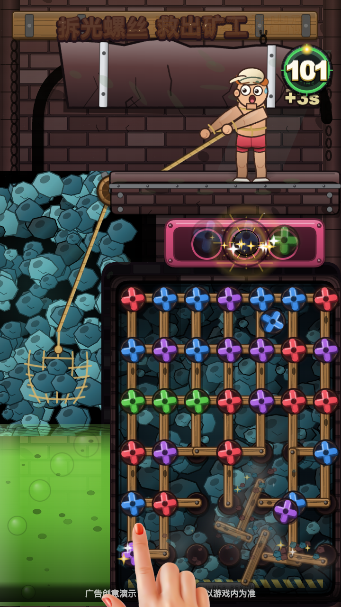
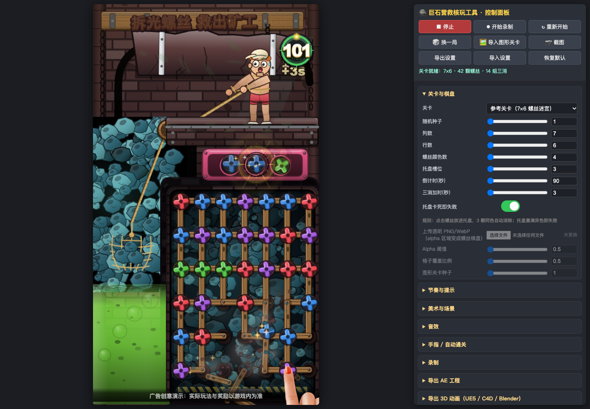
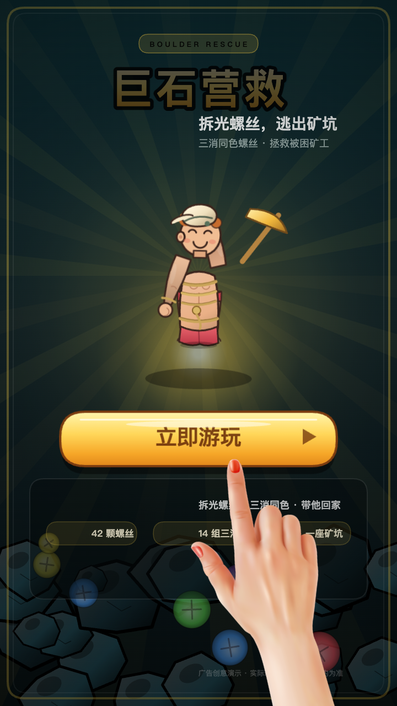
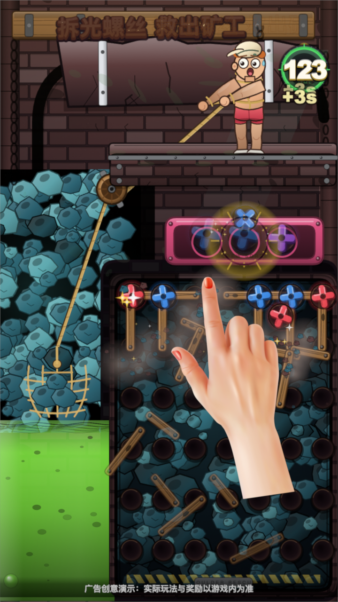

# 巨石营救 · 拯救类核玩工具

> 拆光螺丝，木板塌落，矿工随平台升出矿坑。纯前端、离线单文件，按参考广告的玩法与美术逐帧复刻。

在线体验（GitHub Pages）：<https://ppppan9.github.io/boulder-rescue-tool/>



一个开箱即用的核玩制作工具：**参考关卡 + 保证可解的随机/图形关卡**、马戏团式地牢矿坑美术、螺丝与三消、倒计时、矿工拯救演出、手指自动通关、实时录屏，以及 **AE 工程 / 3D 动画 / H5 试玩广告** 三种导出。所有代码、图像与音效都内联进一个 `index.html`，断网可用，不请求任何 CDN。

## 截图

| 玩法（720×1280） | 工具界面 |
|---|---|
|  |  |
| **原创结束页** | **3D 导出 · Blender 渲染** |
|  |  |

> 截图均由本工具自身渲染；3D 图为导出的 `scene.glb` 在 Blender 无头模式下的实际渲染，不是概念图。

## 打开方式

1. 双击 `index.html`，用桌面版 Chrome / Edge 打开（推荐 Chrome 126+）。
2. 不需要服务器、不需要联网，不需要安装任何依赖。
3. 直接改右侧控制面板，所有设置会自动保存在浏览器 localStorage。

## 玩法

矿工被巨石压在矿坑底部，出口被一排排木板与螺丝封死。

- **点击螺丝**：不需要先拆木板，任意可见螺丝都能拧下并飞入右上角托盘。
- **三颗同色自动消除**：托盘里凑齐三颗同色螺丝会爆开消除，并 **加时 3 秒**。
- **托盘卡死即失败**：托盘默认 3 个槽，塞满三种不同颜色即失败（可在面板关闭）。
- **拆光全部螺丝**：42 颗（7×6 参考关卡）全部拆除后木板逐块坠落，巨石升起，矿工获救。
- **倒计时**：默认 90 秒；归零或托盘塞满都会触发塌方失败。
- **木板与悬石**：木板本身不阻挡点击，两端螺丝都拆掉后才坠落；平台会随拆除进度缓慢上升，通关时再抬升一段。

### 保证有解

生成器始终保证 **每种颜色的螺丝数量是 3 的倍数**，求解器按“一次拿同色三颗”的顺序回放校验，因此随机关卡、参考关卡与导入图形关卡都必定存在合法通关路线。图形关卡会把透明 PNG/WebP 的 alpha 区域映射为螺丝网格，并自动修剪到 3 的倍数。

## 主要功能

### 顶部按钮（固定顺序）

`▶ 自动通关`（运行中变 `■ 停止`）、`⏺ 开始录制`、`↻ 重新开始`、`🎲 换一局`、`🖼 导入图形关卡`、`📷 截图`、`导出设置`、`导入设置`、`恢复默认`。

### 控制面板

- **关卡与棋盘**：参考关卡 / 随机生成 / 导入透明图形；种子、列数、行数、颜色数、托盘槽位、倒计时、三消加时、卡死失败。
- **节奏与提示**：拧起、三消、木板坠落、平台上升、失败与通关演出时长；闲置提示、顶部字幕与底部免责声明。
- **美术与场景**：砖墙、巨石、酸液、木板、托盘、金属高光与强调色；噪点、暗角、螺丝大小、木板宽度、平台抬升、矿工与落石特效开关。
- **音效**：总音量与八类音效独立开关，全部由 WebAudio 实时合成，无外部音频文件。
- **手指 / 自动通关**：速度倍率、移动与点击节奏、思考停顿、落点抖动、手指大小/锚点/旋转/翻转/按压、上传手指、波纹、闲置提示、手指出现时隐藏鼠标。
- **录制**：15–60 fps、MP4（Chrome 支持时）/WebM、码率、自动录制、通关自动停止下载、结束页后继续录制秒数。
- **导出 AE 工程 / 3D 动画 / H5 试玩 / 结束页**：见下。

### 手指与自动通关

默认手指来自本系列 **麻将消除工具** 的同款透明 PNG（`src/default_hand.js`），也可上传自己的手指图片，在预览图上点指尖设置锚点。自动通关会沿缓动路径移动、随机抖动、偶尔“思考停顿”，逐颗点击并真实触发游戏逻辑；手动游玩时手指默认跟随鼠标，手指出现时隐藏系统光标。结束页可选择是否让手指点击 CTA。

### 录制

点击 `⏺ 开始录制` 后开始录右侧画布（棋盘、手指、粒子、字幕、结束页全覆盖）。通关后按设置自动停止并下载；浏览器支持时优先输出 MP4，否则输出 WebM。录制与 AE/3D 时间轴同源，AE 导出时可直接复用同一段记录。

## 导出

### 1. 导出 AE 工程（`boulder_ae_export_*.zip`）

先在面板「导出 AE 工程」点 **● 开始记录**，自动通关或手动游玩，结束后点 **⬇ 导出 ZIP**；也可开启“录制视频时同步记录，停止录制后自动导出”。解压后在 AE 中运行 `build_ae_project.jsx`，脚本会用官方脚本 API 建出完整工程并询问另存为 `.aep`。

ZIP 内含 `build_ae_project.jsx`、`timeline.json`、`README_AE.md`、`assets/<id>.png` 与 `audio/`（`mix.wav` + 逐事件 `sfx_*.wav`）。主合成为「主合成_巨石营救 / Main_BoulderRescue」，固定图层名「手指 / Hand」「结束页 / End card」「免责声明 / Disclaimer」「背景 / Background」。每个螺丝、木板、矿工部件、特效与结束页部件都是独立图层，默认精简为线性关键帧（误差 <0.3px），可切换逐帧烘焙。

### 2. 导出 3D 动画（UE5 / C4D / Blender，`boulder_3d_export_*.zip`）

用同一份记录，在面板点 **导出 3D 动画 (glTF/FBX/Blender)**。ZIP 内含：

| 文件 | 内容 |
|---|---|
| `scene.glb` | 真实二进制 glTF，内嵌全部贴图、逐帧 TRS 动画与透视相机 |
| `scene.fbx` | 真实二进制 FBX（Blender 预设，Y 轴向上），贴图与动画内嵌 |
| `scene3d.json` | 景深、入出点、不透明度曲线、音频事件、相机参数与文件大小统计 |
| `blender_import.py` | Blender 4.x/5.x 一键导入、还原本透明度/显隐/音频，可渲染或二次导出 FBX |
| `timeline.json` | 与 AE 导出同源的原始时间轴 |
| `audio/` | 混合音轨与逐事件音效 |

画布被映射为 7.2×12.8 世界单位（1 单位 = 100 px），每个精灵是按类别分层（背景 −2.55 … 手指 2.35）的带贴图平面，并按景深做透视补偿；在三维软件里环绕相机可以看到真实层次与视差。可参考 ZIP 内 `README_3D.md` 的 Blender / UE5 / C4D 材质说明。

### 3. 导出 H5 试玩广告（`boulder_h5_playable_*.zip`）

面板「导出 H5 试玩广告」可选择 8 个渠道：**AppLovin、Facebook/Meta、Google Ads、Mintegral、Moloco、TikTok、Unity Ads、Generic**。每个渠道是自包含 HTML，无编辑器面板、无 AE/3D 功能，底部 CTA 跳转应用商店或落地页。

- 默认 **不自动通关**、**不包含手指**；玩家自己玩，通关/失败后 CTA 呼吸高亮。
- 支持 contain / letterbox 自适应和 CTA 安全区；可选双端/竖屏/横屏与预览机型。
- Facebook 包单 HTML ≤ 2MB，MRAID 渠道在 ready + viewable 后才开始演示。
- 试玩包只使用本工具生成的原创美术与音效，**不包含任何第三方视频、截图或参考素材**。

### 结束页

结束页为原创矿坑救援插画（非参考视频素材），可改标题、副标题、CTA 文案，可设置出现延迟、是否显示手指，以及编辑器内按钮文字。结束页与免责声明同样进入 AE/3D 导出。

## 设置与兼容

- 设置以 `{app, version, settings}` 包络写入 `localStorage`，带版本号与 `migrate()`；可导出/导入 JSON，可一键恢复默认。
- 推荐 Chrome / Edge 126+；Firefox/Safari 可使用大部分功能，MP4 录制能力取决于浏览器。
- 录屏分辨率与画布一致（720×1280）；AE/3D 可选 24/25/30/60 fps 与 720×1280/1080×1920 合成。

## 测试

```bash
npm install          # 仅开发/测试需要；使用工具本身不需要
npm run build        # 重新生成单文件 index.html
npm run test:logic   # 关卡生成/求解器/托盘规则（197 项）
npm test             # 无头 Chrome 核心联调（47 项）
npm run test:ae      # AE ZIP 结构 + JSX 模拟执行 + 图层重新合成 PSNR
npm run test:3d      # 3D ZIP + GLB/FBX 校验 + Blender 无头导入/渲染（2017 项）
npm run test:h5      # 8 渠道试玩包 + 响应式 + CTA + 真实点击
npm run test:cursor  # 手指/鼠标光标显隐（30 项）
```

3D 测试需要 Blender 5.x 与 Google Chrome（路径见 `test/export3d-export.mjs`），其余测试使用本机 Chrome + Playwright。所有测试都会把临时产物写入 `test/artifacts/`（已在 `.gitignore` 中忽略）。

## 目录

```
index.html              构建后的离线单文件工具（发布物）
src/                    源码：main / level / render / settings / audio / ui / template
src/ae/                 AE 导出器、JSX 构建脚本、录制器
src/export3d/           3D 导出器与 Blender 导入脚本
src/h5/                 H5 试玩导出器
test/                   逻辑、核心、AE、3D、H5、光标测试
screenshots/            本工具渲染的发布截图
docs/                   参考分析（内部）与实现说明
```

## 素材与许可

所有场景、螺丝、木板、矿工、巨石、托盘、UI、结束页与音效均为程序化绘制/合成；默认手指素材来自同系列的麻将消除工具，可在面板中替换。参考广告视频仅用于内部逐帧研究，**未随仓库分发**，仓库与截图中不含参考视频、参考帧或其中的品牌/角色素材。

内联的第三方代码：three.js r170（MIT）、`@comfyorg/fbx-exporter-three` 1.0.2（MIT）、fflate 0.8.3（MIT）。完整许可见 [`THIRD_PARTY_LICENSES.txt`](THIRD_PARTY_LICENSES.txt)。

## v1.0.0

首个版本：参考关卡、保证可解的随机与图形关卡、地牢矿坑美术与矿工拯救演出、三消托盘/倒计时、手指自动通关、MP4/WebM 录制、AE 工程导出、真实 GLB/FBX + Blender 脚本的三维导出、8 渠道 H5 试玩、结束页与完整测试链路。
